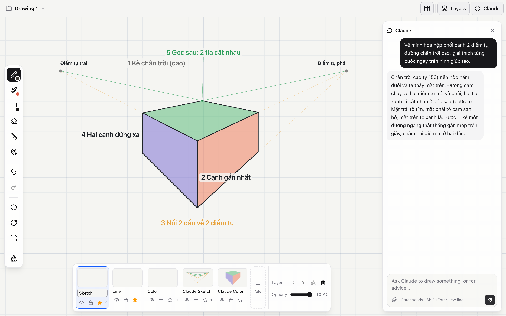
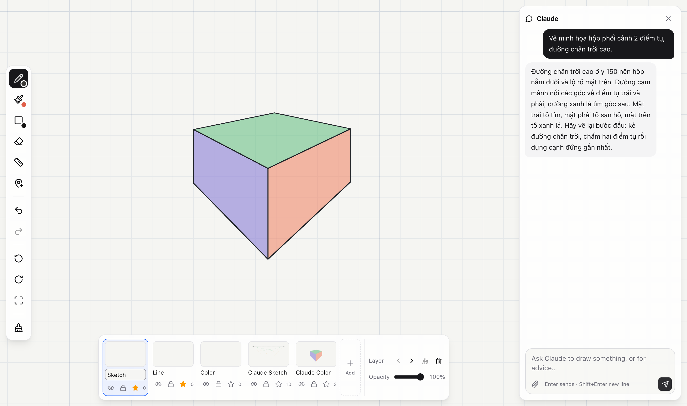
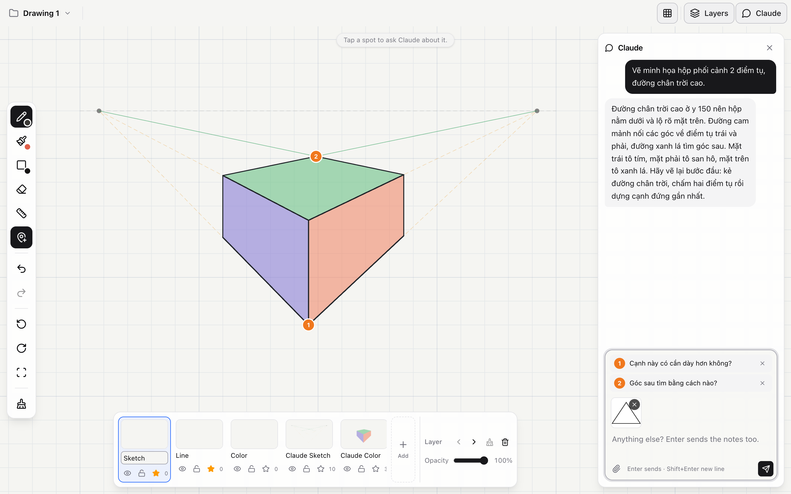
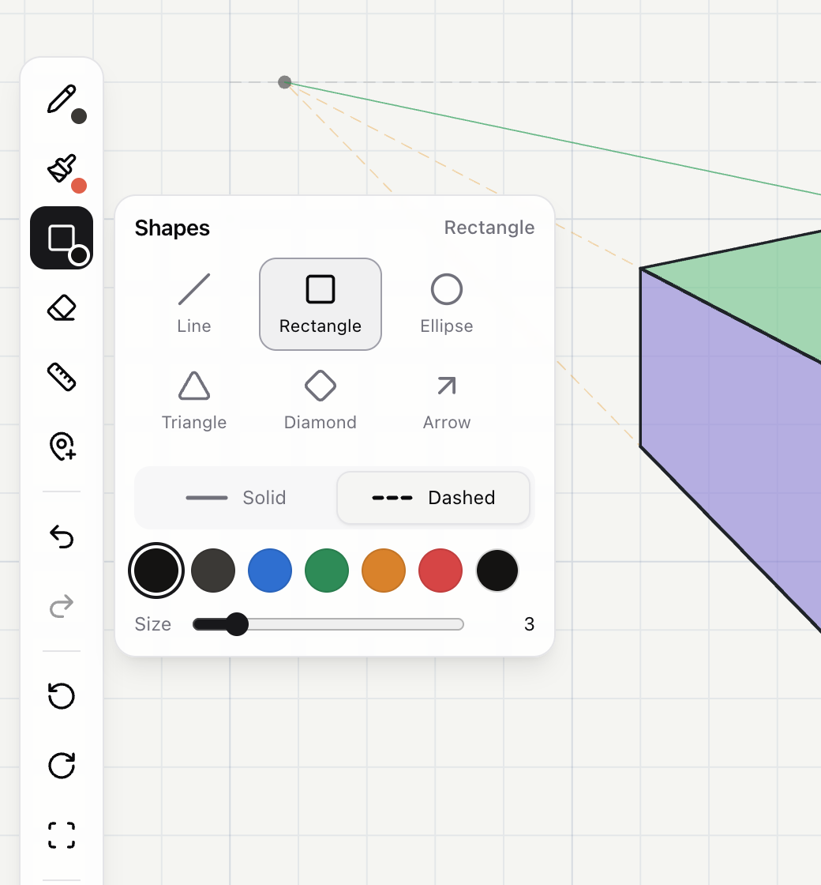
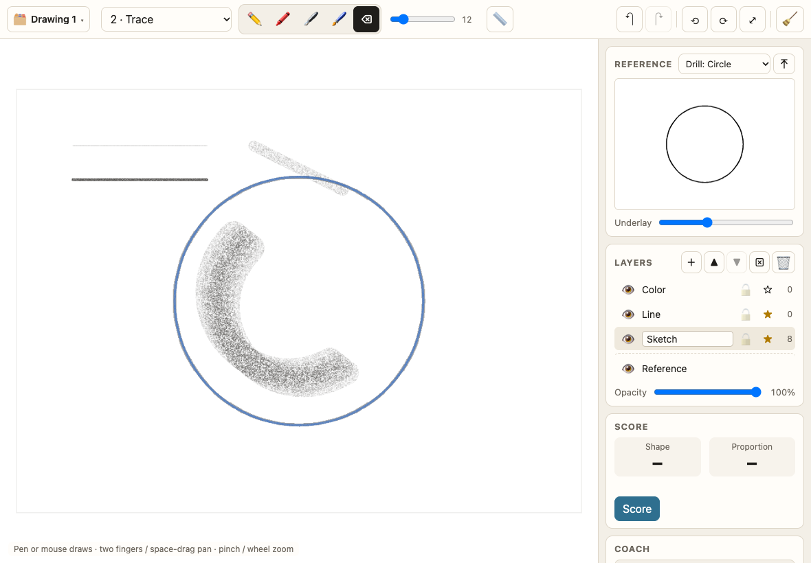
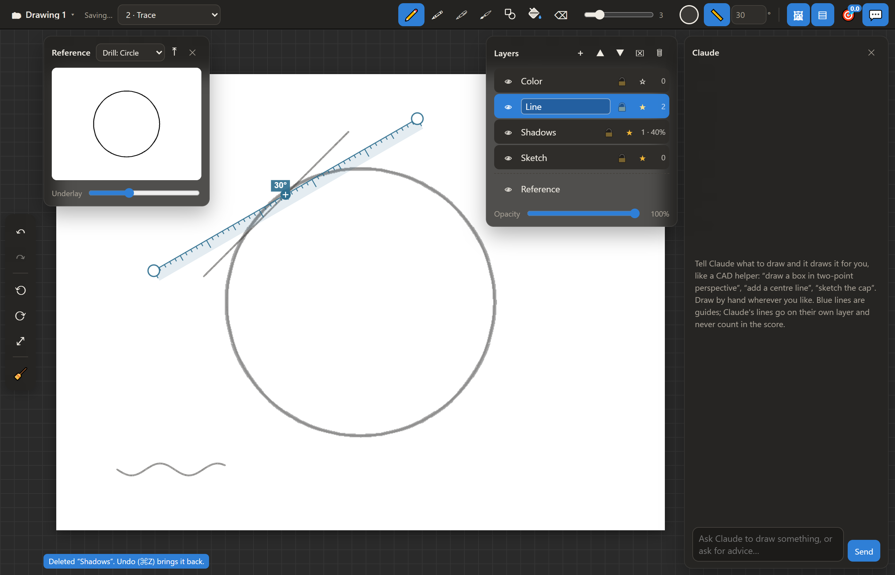
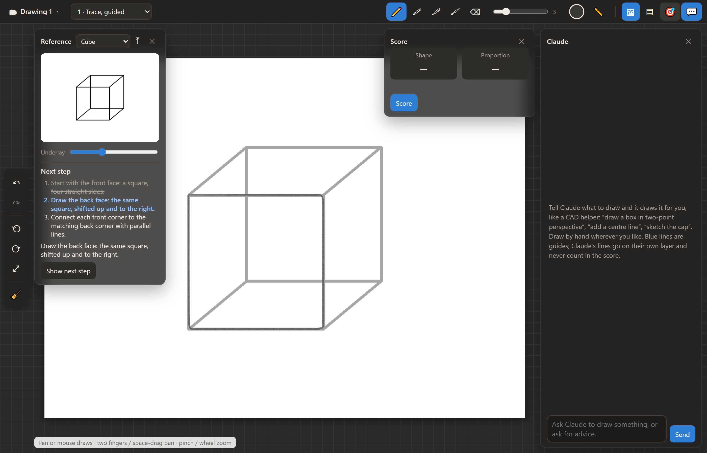

# ✏️ drawing-room

**A local sketchbook with a drawing teacher in it.** Draw by hand with real pen pressure and tilt (Apple Pencil on an
iPad, or a Wacom / XP-Pen / Huion tablet), and ask Claude to explain, correct or construct things for you, right on
the paper: a two-point perspective box built step by step, with every step numbered and labelled where it happens.



- 🖊️ **A real pen**: pressure and tilt straight from the browser, so the iPad only needs Safari. A pencil with grain, ink, marker, brush,
  shading, highlighter and dragged-out shapes.
- 🧑‍🏫 **A teacher, not a filter**: Claude draws on its own layers, writes its explanation onto the drawing, answers
  notes you pin on a spot, and looks at pictures you drop in the chat.
- 🗂️ **Your work stays on your machine**: projects save themselves on the computer, and the iPad opens the same ones over
  Wi-Fi.
- 🎯 **Practice mode with a deterministic score** (`?practice`): trace or draw from a reference, scored on shape and
  proportion, with a review at the end.

---

## Quick start

You need Python 3.11 or 3.12 and [uv](https://docs.astral.sh/uv/). For Claude you need either the
[Claude Code](https://claude.com/claude-code) command line (`claude`, signed in), or `ANTHROPIC_API_KEY` with
`uv sync --extra api`.

```bash
uv sync
uv run drawing-room serve                 # http://127.0.0.1:8430, this computer only
uv run drawing-room serve --lan           # also on your Wi-Fi for the iPad; prints the address to open
uv run drawing-room serve --lan --pin     # on a shared network: also asks for a 6-digit PIN
uv run drawing-room serve --port 9000 --data ~/drawings   # projects live in ~/.drawing-room/projects by default
```

On the iPad, open the printed `http://<computer-ip>:8430` in Safari. Everything is served by the computer, so the iPad
needs no internet. Claude needs the computer to reach it.

---

## A tour

<table>
  <tr>
    <td width="50%"><br><sub><b>Construction you can switch off.</b> Claude draws in four line weights on separate layers. Hide its Sketch layer and a clean box is left.</sub></td>
    <td width="50%"><br><sub><b>Ask about a spot.</b> Pin numbered notes on the paper (N) and attach pictures. They go with your next message, and Claude answers each note by number.</sub></td>
  </tr>
  <tr>
    <td><br><sub><b>Toolbox.</b> Write, Paint and Shapes each open a flyout with their tools, colours and size. Shapes come solid or dashed.</sub></td>
    <td><br><sub><b>A pencil that behaves like one.</b> Press harder for a darker line, and tilt the pen for grainy shading.</sub></td>
  </tr>
  <tr>
    <td><br><sub><b>Layers.</b> A strip of cards that show what is on each layer. Hide, lock, set opacity, reorder, and ★ the ones that count in practice.</sub></td>
    <td><br><sub><b>Ruler.</b> Run a stroke along it to draw straight. Turn it in 15° steps or type an exact angle.</sub></td>
  </tr>
  <tr>
    <td><br><sub><b>Practice: trace, guided.</b> A step list for each reference, with the next step named after every stroke.</sub></td>
    <td><br><sub><b>Scored, not guessed.</b> Shape and proportion out of 10, with missed (M) and stray (S) regions boxed.</sub></td>
  </tr>
  <tr>
    <td><br><sub><b>Review on submit.</b> Claude reads the numbers and the overlay, then says what to practise next.</sub></td>
    <td><br><sub><b>Projects.</b> Every drawing saves itself on the computer and opens on the iPad too.</sub></td>
  </tr>
</table>

---

## Claude, your drawing teacher 🧑‍🏫

Open the chat with the **Claude** button (top right). Write in any language; Claude answers in yours.

| Ask for… | What happens |
| --- | --- |
| **Something drawn**: "draw a box in two-point perspective", "add a centre line", "sketch the cap" | Claude draws it as lines, circles, ellipses, arcs, curves, filled faces and text, on layers of its own that are never scored. One undo takes back everything it drew for that message, and "redo it" replaces it. |
| **An explanation** | Claude writes it **on the drawing**. Short labels sit beside the points that matter, and numbered steps follow the drawing order ("1 Draw the horizon"), on its **Notes** layer. The chat reply then refers to the step numbers. |
| **A perspective illustration** | One box per picture, in four line weights. **Sketch**: the faint dashed construction (orange to the side vanishing points, blue to the third) and the green lines that find the hidden corner. **Color**: the faces at 60% (left purple, right coral, top or bottom green). **Line**: the bold visible edges, nearer ones thicker. A layer is called "Claude Sketch" when you already have a "Sketch". |
| **About one spot** | Press **N** (or the pin in the toolbox), tap the spot and write the question. A numbered orange pin marks it, and the note waits above the message box (× removes it). Claude gets each note with its position, sees the pins, and answers by number. |
| **About a picture** | Attach up to 4 pictures a message: use the paperclip, paste a screenshot, or drop a file anywhere on the page. They are scaled to 1600 px and sent with that message only, and a thumbnail stays in the chat. |

The chat is saved with the project. Claude sees the sheet (plus anything drawn past it) with a coordinate grid. Your
strokes appear in black and its own in blue, so it never mistakes its work for yours.

---

## Drawing

**Paper.** Soft off-white paper fills the screen with no border, so you can draw anywhere. A squared grid moves, zooms and turns with
the drawing: a line every 50 units, a darker one every 250. Turn it off with the grid button or **G**. The sheet
shape in the project menu (4:3, A4 landscape or portrait, square, 16:9, 9:16) sets what the view fits to.

**Tools** (left edge). Tap a group to pick its tool, and tap it again for its flyout: the group's tools, six colours
plus any colour, and the size. Each tool keeps its own size. A colour is shared within its group, so the pencil and
the ink match while the highlighter stays yellow.

| Group | Tools |
| --- | --- |
| ✏️ **Write** | **Pencil**: graphite with grain. Light pressure gives a thin, pale line and firm pressure a dark one; lay the pen on its side to shade. **Ink**: crisp. **Marker**: an even felt-tip. |
| 🖌️ **Paint** | **Colour brush**. **Shade**: the tilted-pencil band, for a mouse or trackpad. **Highlighter**: wide and multiplied onto the paper, so lines under it stay dark. **Paint bucket**: tap inside a closed shape to pour colour into it, like Paint. It fills under the layer's lines, and its size is how wide a gap in the lines it still treats as closed. |
| ⬜ **Shapes** | Line, rectangle, ellipse, triangle, diamond and arrow, solid or dashed. Hold Shift for a square, a circle, or a line in 15° steps. |
| 💧 **Colour picker** | Tap the drawing or the reference picture to take its colour, then you are back on your tool. ⌥-click does the same with any colour tool. |
| 🧽 **Eraser** | Removes whole strokes on the active layer, including Claude's filled faces and labels. |
| 📏 **Ruler** | Start a stroke against it and run along it, and the stroke lands on its edge; heading off across it stays freehand. Drag the ends to turn it, the middle to move it, or type an angle. |
| 📍 **Note** | Pins a question on a spot for Claude (see above). |

**Files.** Projects save themselves as you draw; the note beside the project name says Saving… or Saved ✓, and **⌘S**
saves at once. The project menu also has:
- **Save file** (**⇧⌘S**): downloads the project as a `.drawing.json` file. **Open file…** opens one as a new project.
- **Export PNG / JPG**: the drawing on white, with every visible layer and anything drawn past the sheet. The
  reference and the grid are left out.

**Layers** (the strip at the bottom). Each card shows what is on that layer, zoomed onto its own strokes. A new drawing
starts with Sketch, Line and Color, and you can have up to 24. Tap a card to draw on that layer, and tap the active
layer's name to rename it. Each layer can be hidden, locked, given its own opacity, moved, cleared or deleted, and all
of that is undoable. Scroll the strip sideways with a horizontal wheel, a normal wheel or a swipe.

**View.**
- On the iPad: two fingers pan, pinch-zoom and twist.
- On a computer: space-drag to pan, the wheel or a trackpad pinch to zoom, and Alt+wheel or R to rotate.
- Palm rejection: once a pen has touched the paper, fingers only move the paper.

Strokes are stored as vectors (x, y, pressure, time, tilt), drawn with vendored
[perfect-freehand](https://github.com/steveruizok/perfect-freehand) (MIT).

### Keyboard

| Key | | Key | |
| --- | --- | --- | --- |
| `P` `I` `M` | pencil, ink, marker | `B` `S` `H` | brush, shade, highlighter |
| `F` | paint bucket | `K` | colour picker |
| `U` | shapes | `E` | eraser |
| `⌘S` | save now | `⇧⌘S` | save a project file |
| `L` | ruler | `N` | note for Claude |
| `G` | grid on / off | `[` `]` | smaller / bigger |
| `⌘Z` / `⇧⌘Z` | undo / redo | `⇧N` | new layer |
| `R` / `⇧R` | rotate the paper | `0` | fit the paper |
| `Space`+drag | pan | `Esc` | close menus, leave Note |

### Pen tablets (Wacom, XP-Pen, Huion)

**Windows.** A screenless tablet such as the XP-Pen Deco Fun works in Chrome or Edge.
- Install the maker's driver and turn on **Windows Ink** in it (XP-Pen: PenTablet → Pen → Windows Ink). Without it the browser sees a mouse, with no pressure or tilt.
- If a long press shows a circle or the first stroke lags, turn off the press-and-hold effects in Settings → Bluetooth & devices → Pen & Windows Ink. Keep Windows Ink on in the driver.

**Android.** Plug the tablet in over USB OTG and open the `--lan` address in Chrome.

---

## Practice mode (`?practice`)

Open `http://127.0.0.1:8430/?practice` to bring back the practice menu, references and the score. Free drawing hides
them. A reference saved with a project stays in its file either way.

| Level | What it is |
| --- | --- |
| 0 · Warm-up | Drills: a line between two dots, a circle, an ellipse. Scored after every stroke. |
| 1 · Trace, guided | The reference under your paper plus a step list. The next step is named after each stroke. |
| 2 · Trace | The reference underneath, no steps; Claude when you ask. |
| 3 · From reference | Nothing underneath. Size and position don't count, proportions do. |
| 4 · Test | No help at all. Press Submit and Claude reviews the drawing. |

References are built in (line, circle, ellipse, cube, cylinder, apple, all drawn in code), or you can upload your own
image.

**Scoring** (`POST /api/score`, [`scoring.py`](src/drawing_room/scoring.py)) is deterministic:
1. The reference becomes thin centre lines. Built-ins are rendered from vectors, line art is thresholded, and photos get edge detection.
2. Your strokes on visible ★ layers are rasterised at a constant width. Shading is left out.
3. At levels 3–4, your ink is moved and scaled onto the reference first. It is never rotated.
4. Distance transforms give recall and precision. **Shape** is their F-score out of 10. **Proportion** compares width and height spread separately, so a squashed circle loses points.
5. Missed (M1…) and stray (S1…) regions come back as boxes, along with stroke stats for the coach.

---

## How it works

- **Server**: Python stdlib HTTP ([`server.py`](src/drawing_room/server.py)).
- **App**: vanilla ES modules with no bundler ([`static/js/`](src/drawing_room/static/js)).
- **UI**: Tailwind v4 with shadcn/ui tokens and vendored Lucide icons.

| Route | Does |
| --- | --- |
| `POST /api/assist` | The chat ([`assist.py`](src/drawing_room/assist.py)). It renders the sheet with a labelled grid, your strokes, Claude's earlier strokes, the note pins, and any attached pictures, then asks Claude for a reply plus shapes as JSON: `line`, `polyline`, `rect`, `circle`, `ellipse`, `arc`, `bezier` and `label`. Each shape can have a layer, colour, width, opacity, dash or fill. The server checks every shape and samples it into points; a bad shape is skipped, not fatal. |
| `POST /api/coach` | Scores the drawing, composites an overlay and asks Claude for advice. Claude gets the machine numbers and is told never to invent scores or coordinates. |
| `POST /api/score` | The deterministic score above. |
| `/api/projects…` | List, create, save, rename and delete projects. |

Claude runs through `claude -p` with only the Read tool allowed and without your user settings or MCP servers. If
`ANTHROPIC_API_KEY` is set and `anthropic` is installed, it uses the Messages API with the images inline instead.

### Security

- **Binding.** By default the server binds to 127.0.0.1 and rejects foreign Host and Origin headers.
- **LAN mode.** `--lan` answers only devices on the local network, and Origin must still match Host. `--pin` puts a PIN on every `/api` route (HttpOnly, SameSite=Strict cookie, rate limited).
- **Input limits.** Project ids are made by the server and checked before they touch a file name. Bodies are capped at 16 MB, 3000 strokes and 300k points. Each message takes at most 4 pictures and 12 notes.
- **Logging.** Every POST logs its request, response and error. Set `DRAWING_ROOM_GRAYLOG=host:port` to send them as GELF over UDP. PINs and image data are redacted, and strokes are summarised.

---

## Development

```bash
uv run pytest      # server, scoring, assist (shapes, labels, notes, pictures), PIN/Origin, logging; claude mocked
npm test           # node --test: strokes, pencil, tools, shapes, bucket fill, export, undo/redo, layers, ruler, paper, notes, view math
npm run build      # after changing the UI: Lucide icons -> static/js/icons.js, Tailwind -> static/styles.css
```

The browser checks drive Google Chrome with Playwright, and they create projects. Run each one against a throwaway
server and data directory, never your real one. They save screenshots to the folder you give, so use a temporary one
and copy over only the pictures the README uses:

```bash
uv run drawing-room serve --port 8499 --data "$(mktemp -d)" &
SHOTS="$(mktemp -d)"
uv run --with playwright python scripts/e2e_projects.py      http://127.0.0.1:8499/ "$SHOTS"
uv run --with playwright python scripts/e2e_pencil.py        http://127.0.0.1:8499/ "$SHOTS"
uv run --with playwright python scripts/e2e_layers_ruler.py  http://127.0.0.1:8499/ "$SHOTS"
uv run --with playwright python scripts/e2e_files.py         http://127.0.0.1:8499/ "$SHOTS"
uv run --with playwright --with pillow python scripts/e2e_browser.py "$SHOTS" http://127.0.0.1:8499/   # calls Claude
```

Layout:

| Path | Holds |
| --- | --- |
| `src/drawing_room/` | Server, scoring, references, coach and assist. |
| `src/drawing_room/static/` | HTML, ES modules and the built CSS. The CSS is committed so the app runs without Node. |
| `src/drawing_room/static/vendor/` | perfect-freehand and the Lucide licence. |
| `src/drawing_room/styles/app.css` | The Tailwind source. |
| `tests/`, `js-tests/`, `scripts/` | Python tests, JavaScript tests and the browser checks. |

## Roadmap

- 3D-model lessons with step-by-step construction lines (from cadsmith/CadQuery or three.js).
- Timed gesture drills, and a journal of progress with stroke replay.
- Auto level-up: three drawings scoring 8 or more move you to the next level.
- Value (light/dark) and colour scoring.
- A pixel eraser. Today the eraser removes whole strokes.
