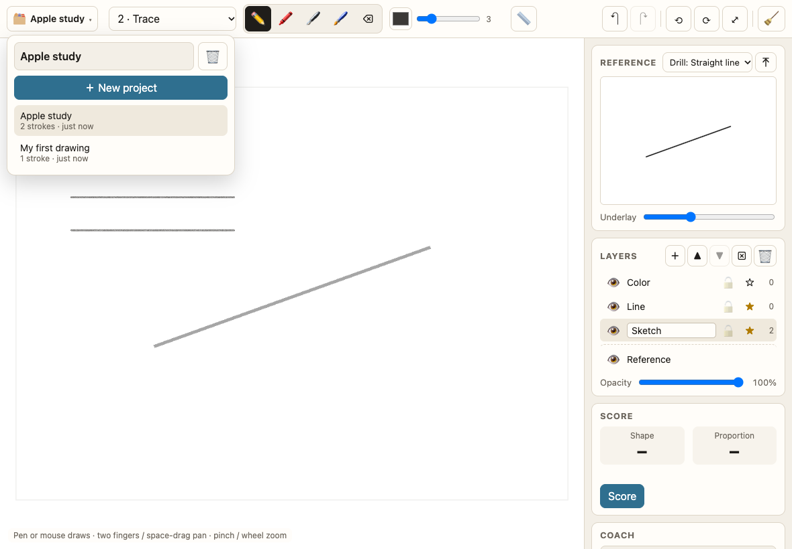

# drawing-room

A local practice room for learning to draw by hand. You draw on a pressure-sensitive paper (Apple Pencil on iPad,
Wacom/XP-Pen on a Mac) next to a reference. A deterministic scorer compares your lines to the reference, and an AI coach
(Claude) explains what to fix and what to do next.


## Run it

Needs Python 3.11/3.12 and [uv](https://docs.astral.sh/uv/). The coach uses the local
[Claude Code](https://claude.com/claude-code) command line (`claude`, signed in), or the Messages API if
`ANTHROPIC_API_KEY` is set and you install the extra (`uv sync --extra api`).

```bash
uv sync
uv run drawing-room serve            # http://127.0.0.1:8430 on this Mac only
uv run drawing-room serve --lan      # also on your Wi-Fi, for the iPad; prints the address
uv run drawing-room serve --lan --pin   # on a shared network: also asks for a 6-digit PIN printed at start-up
uv run drawing-room serve --port 9000 --data ~/drawings   # projects live in ~/.drawing-room/projects by default
```

On the iPad, open the printed `http://<mac-ip>:8430` address in Safari.
All JavaScript is served by the Mac, so the iPad needs no internet; the coach needs the Mac to reach Claude.

## What you can do

- **Projects** (🗂 at the top left): every drawing is a project kept on the Mac, so the iPad and the Mac open the same
  work. New (named straight away), open any project from the list, rename it, or delete it. Changes save themselves
  about a second after you stop, and a copy kept in the browser covers a reload or a closed tab before that. A drawing
  from before projects becomes "My first drawing".

  
- **Paper**: white across the whole drawing area. The faint frame is the reference and scoring area; at levels 3–4
  you can draw anywhere, since size and position are ignored.
- **Tools**: pencil, shade, ink, color brush and an eraser that removes whole strokes. Every tool works on the active
  layer and keeps its own size and colour (the slider and swatch next to the tools; `[` / `]` change the size). Strokes follow pen pressure (via vendored
  [perfect-freehand](https://github.com/steveruizok/perfect-freehand), MIT) and are stored as vectors: every point keeps
  x, y, pressure, time and tilt, so drawings can be replayed and analysed. Undo/redo (⌘Z / ⇧⌘Z).
- **Pencil** (P): graphite with paper grain. Press lightly for a thin, pale line and harder for a thick, dark one.
  Lay an Apple Pencil or Wacom pen low on its side and the stroke turns into shading: a broad, light, grainy band
  that darkens as you go over it again. With a mouse or trackpad (no tilt), use **Shade** (S) for the same band.
  The swatch makes it a coloured pencil. Shading is tone, not line, so it never counts towards the score.

  
- **Toolbar**: one row on an iPad in landscape (icons with tooltips; labels on wider screens), two rows in portrait.
  The reference picker and upload sit in the Reference panel.
- **Layers**, like a paint program. A new drawing starts with Sketch, Line and Color; add up to 24 (＋ or ⇧N), and a
  new layer opens with its name field ready to type. Tap a layer to draw on it, tap the active layer's name to rename it.
  Each layer can be hidden (👁), locked (🔒, takes no strokes and no erasing), set to its own opacity, moved up or down,
  cleared on its own, or deleted. Adding, deleting, moving and renaming are undoable like strokes. ★ marks the layers
  that count towards the score (Color is off by default). The reference image sits under the stack with its own
  opacity slider. Old v0 drawings are upgraded on load.
- **Ruler** (📏 or L, levels 1–4): a straightedge on the paper. Start a stroke against it and the whole stroke lands on
  its edge. Drag an end to turn it (snaps to 15° steps; hold ⌥ for any angle), drag the ⊕ in the middle to move it, or
  type an exact angle next to the button. The angle is shown on the ruler. It is not offered in the warm-up drills.
- **View**: two fingers pan, pinch-zoom and twist-rotate on the iPad; space-drag to pan, wheel or trackpad pinch to zoom,
  Alt+wheel or R / ⇧R to rotate, 0 to fit on the Mac.
- **Palm rejection**: once a pen has touched the paper, fingers never draw; they only move the paper.
- **References**: built-in line, circle, ellipse, cube, cylinder and apple (drawn in code), or upload your own image. The
  reference is always shown beside the paper.
- **Levels**:
  - 0 Warm-up — drills (line between two dots, circle, ellipse), only the guide dots on the paper, auto-scored.
  - 1 Trace, guided — underlay plus a step list; after each stroke the next step is highlighted on the paper and the
    reference (for uploads: the biggest area you have not drawn yet). Claude never draws strokes.
  - 2 Trace — coach only when you press *Ask coach*.
  - 3 From reference — no underlay, coach when asked. Size and position do not matter, proportions do.
  - 4 From reference, review at the end — the coach stays silent until *Submit*.

## Scoring

`POST /api/score`, all in [`scoring.py`](src/drawing_room/scoring.py), deterministic:

1. Reference lines: built-ins are rendered from their vectors; uploaded line art is thresholded; photos go through
   edge detection (best effort). Thick lines are thinned to a centre line.
2. Your strokes on visible ★ layers are rasterised at a constant thin width (pressure does not change the score).
   Shading strokes (the Shade tool, or a tilted pencil) are left out.
3. Levels 3–4 first move and uniformly scale your ink onto the reference (centroid and spread; never rotation).
4. A distance transform gives *recall* (share of the reference with your ink nearby) and *precision* (share of your ink
   near the reference), with a few pixels of full credit fading to zero a little further out.
   **Shape** = F-score on 0–10. **Proportion** compares width and height spread separately, so a squashed circle loses it.
5. Missed reference lines (M1, M2…) and stray lines (S1, S2…) come back as boxes in your drawing's coordinates, and
   stroke stats (count, mean length, share of short scratchy strokes) feed the coach.

## Coach

`POST /api/coach` scores the drawing, composites an overlay (reference faint red, your ink black, regions boxed yellow)
into a temp folder and runs `claude -p` with only the Read tool allowed and without your user settings or MCP servers.
Claude gets the machine numbers, region ids, stroke stats, level and your question, and is told never to invent scores or
coordinates. With `ANTHROPIC_API_KEY` set (and `anthropic` installed) it calls the Messages API with the images inline.

## Security

- Binds to 127.0.0.1 by default and rejects foreign Host and Origin headers.
- `--lan` binds 0.0.0.0 and answers only devices on the local network: loopback, private and link-local addresses, or
  the same /16 as one of the Mac's own addresses (for home networks on public-looking ranges). Origin must still match
  Host. `--pin` adds a PIN for every `/api` route (HttpOnly, SameSite=Strict cookie; wrong PINs are rate limited).
- Project ids are made by the server and checked against a strict pattern before they are used in a file name.
- Request bodies are capped (16 MB, 3000 strokes, 300k points).
- Every POST logs request, response and error in a `finally` block; set `DRAWING_ROOM_GRAYLOG=host:port` to send them
  to Graylog as GELF over UDP. PINs and image data are redacted, and strokes (also inside project saves) are summarised.

## Development

```bash
uv run pytest            # scoring, server, PIN/Origin, logging, coach prompt (claude mocked)
npm test                 # node --test: stroke model, pencil, tools, undo/redo, layers, ruler, view math, palm rejection
uv run --with playwright --with pillow python scripts/e2e_browser.py docs/screenshots   # with the server running; uses Google Chrome
uv run --with playwright python scripts/e2e_layers_ruler.py http://127.0.0.1:8430/ docs/screenshots
uv run --with playwright python scripts/e2e_pencil.py http://127.0.0.1:8430/ docs/screenshots
# The browser checks write projects: run each against a server with an empty data dir, never your real one:
#   uv run drawing-room serve --port 8431 --data "$(mktemp -d)" &
```

Layout: `src/drawing_room/` (server, scoring, references, coach), `src/drawing_room/static/` (HTML/CSS/ES modules, no
build step; `vendor/` holds perfect-freehand and its license), `tests/`, `js-tests/`.

## Roadmap (not in v0)

- 3D-model lessons with step-by-step construction lines (from cadsmith/CadQuery or three.js).
- Timed gesture drills.
- Journal and progress history with stroke replay.
- Auto level-up (three drawings scoring 8 or more → next level).
- Value (light/dark) and color scoring.
- Pixel (partial) eraser; the v0 eraser removes whole strokes.
