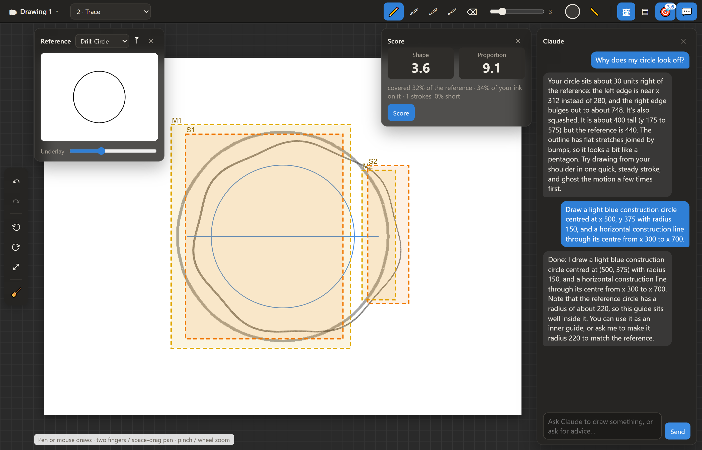
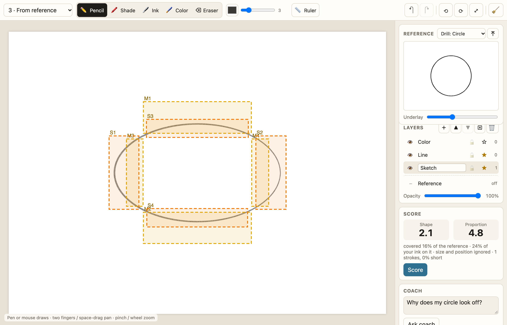
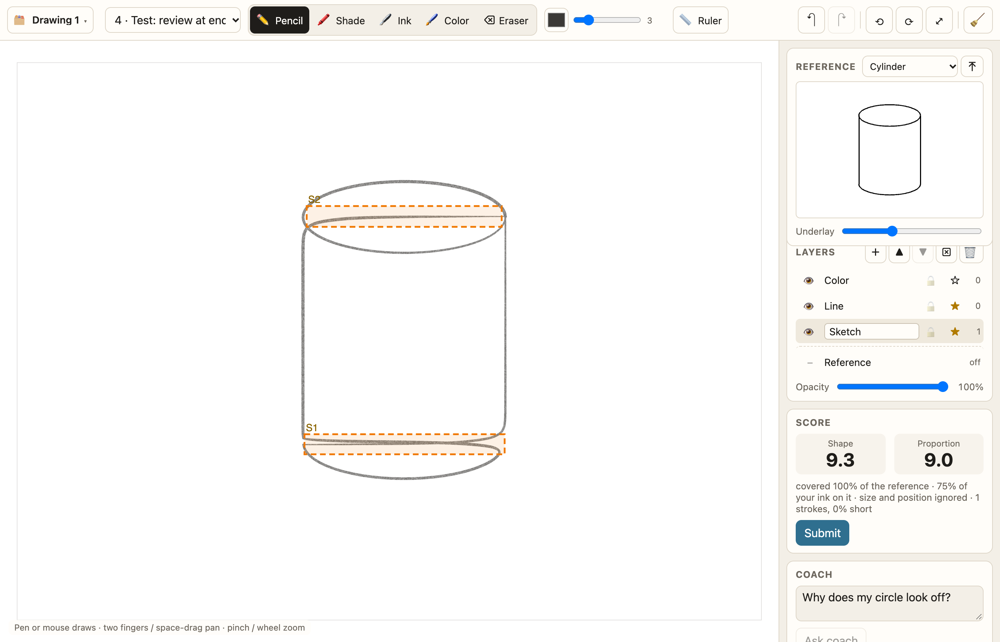
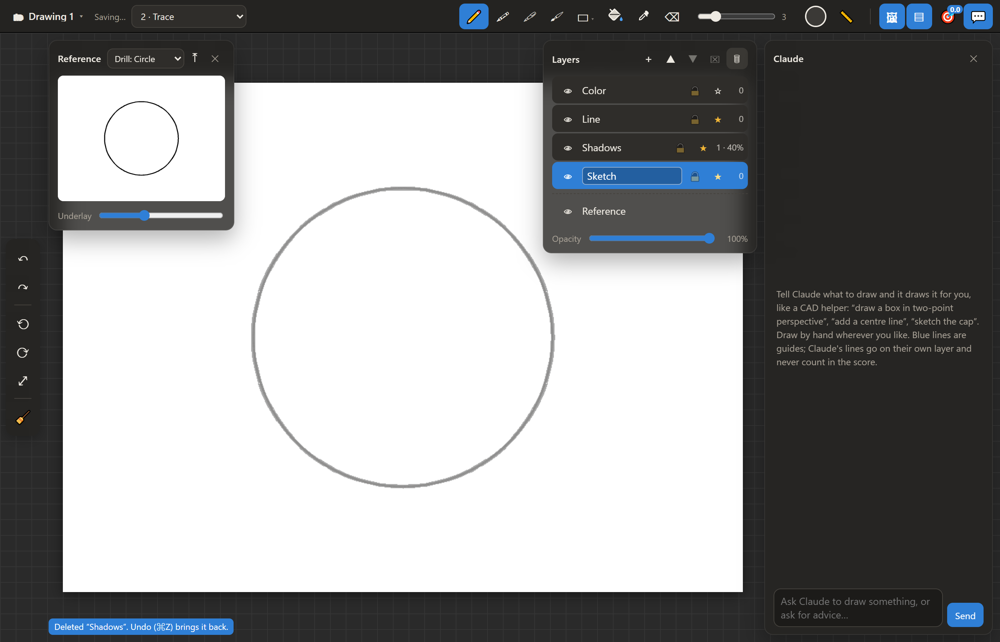
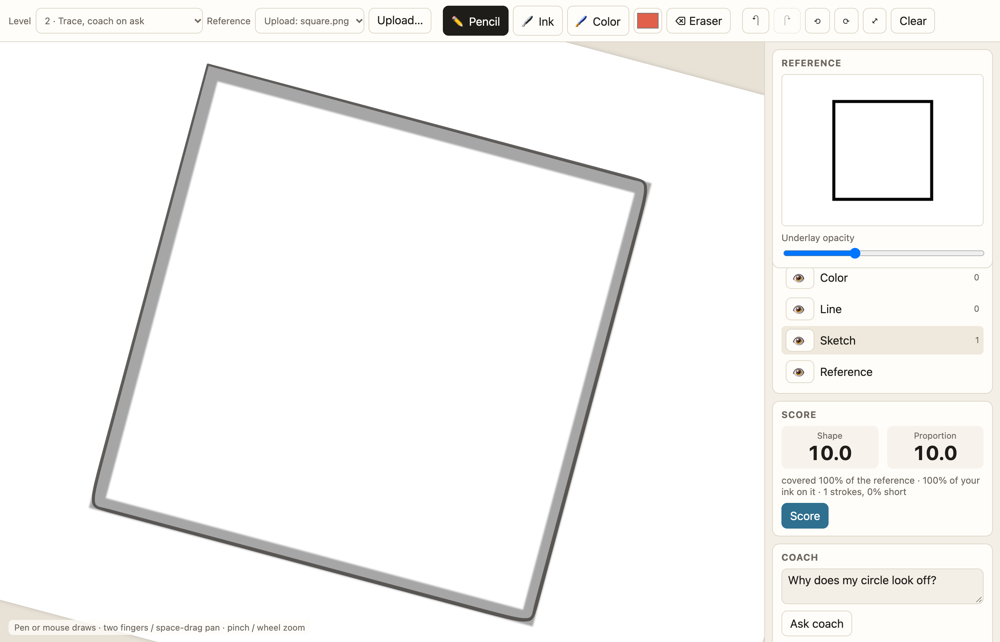

# ✏️ drawing-room

**A local practice room for learning to draw by hand.** Draw with real pen pressure and tilt (Apple Pencil on an iPad,
or a Wacom / XP-Pen / Huion tablet on a computer) next to a reference. A deterministic scorer compares your lines to it,
and Claude coaches you, or draws construction lines for you like a CAD helper.



<table>
  <tr>
    <td width="50%"><br><sub><b>Trace, guided</b>: a step list for each reference, and the next step is named after every stroke.</sub></td>
    <td width="50%"><br><sub><b>Scored, not guessed</b>: shape and proportion out of 10, with missed (M) and stray (S) regions boxed.</sub></td>
  </tr>
  <tr>
    <td><br><sub><b>Review on submit</b>: Claude reads the numbers and the overlay, then tells you what to practise next.</sub></td>
    <td><br><sub><b>A real pencil</b>: pressure for line weight, tilt the pen for grainy shading, any colour.</sub></td>
  </tr>
  <tr>
    <td><br><sub><b>Layers</b>: hide, lock, opacity, reorder, and ★ the ones that count towards the score.</sub></td>
    <td><br><sub><b>Ruler</b>: strokes snap to its edge; turn it in 15° steps or type an angle.</sub></td>
  </tr>
  <tr>
    <td><br><sub><b>Turn the paper</b>: pan, pinch-zoom and twist like a real sheet.</sub></td>
    <td><br><sub><b>Projects</b>: every drawing saves itself on the computer and opens on the iPad too.</sub></td>
  </tr>
</table>

## Highlights

- 🖊️ **Pressure and tilt** from the browser's Pointer Events: no app to install on the iPad, just Safari.
- 📐 **Five levels**, from warm-up drills to drawing from a reference with a review at the end.
- 🎯 **A deterministic score**: distance transforms on the lines themselves, so the same drawing always gets the same number.
- 🤖 **Claude as a coach and a CAD helper**: ask "draw a box in two-point perspective" and it draws guides on its own layer.
- 🔒 **Local first**: the server runs on your own machine and binds to 127.0.0.1 unless you ask for the LAN.

## Run it

Needs Python 3.11/3.12 and [uv](https://docs.astral.sh/uv/). The coach uses the local
[Claude Code](https://claude.com/claude-code) command line (`claude`, signed in), or the Messages API if
`ANTHROPIC_API_KEY` is set and you install the extra (`uv sync --extra api`).

```bash
uv sync
uv run drawing-room serve            # http://127.0.0.1:8430 on this Mac only
uv run drawing-room serve --lan      # also on your Wi-Fi, for the iPad; prints the address
uv run drawing-room serve --lan --pin   # on a shared network: also asks for a 6-digit PIN printed at start-up
uv run drawing-room serve --port 9000 --data ~/drawings   # projects live in ~/.drawing-room/projects by default
```

On the iPad, open the printed `http://<mac-ip>:8430` address in Safari.
All JavaScript is served by the Mac, so the iPad needs no internet; the coach needs the Mac to reach Claude.

### Pen tablets (Wacom, XP-Pen, Huion)

A screenless tablet such as the XP-Pen Deco Fun works in Chrome or Edge. Install the maker's driver, and on Windows
turn on **Windows Ink** in it (XP-Pen: PenTablet → Pen → Windows Ink). Without it the browser sees a mouse, so there is
no pressure or tilt. If a long press then shows a circle or the first stroke lags, turn off the press-and-hold effects
in Settings → Bluetooth & devices → Pen & Windows Ink, but leave Windows Ink on in the driver. On Android, plug the
tablet in over USB OTG and open the `--lan` address in Chrome.

## What you can do

- **Projects** (🗂 at the top left): every drawing is a project kept on the Mac, so the iPad and the Mac open the same
  work. New (named straight away), open any project from the list, rename it, or delete it. Changes save themselves
  about a second after you stop, and a copy kept in the browser covers a reload or a closed tab before that. A drawing
  from before projects becomes "My first drawing".
- **Paper**: a white sheet on a dark desk with a fine grid. Pick its shape in the project menu (🗂 → Paper): 4:3 (the
  reference frame), A4 landscape or portrait, square, 16:9 or 9:16. The reference and scoring frame always sits in the
  middle of the sheet (shown as a faint outline on the bigger sheets), and strokes are clipped to the sheet. At levels
  3–4 size and position are ignored, so you can draw anywhere on it.
- **Toolbox** (left edge): **Write** holds the pencil (P), ink (I) and marker (M); **Paint** holds the colour brush (B),
  Shade (S) and the highlighter (H); **Shapes** (U) drags out a line, rectangle, ellipse, triangle, diamond or arrow
  (hold Shift for a square, a circle, or a line at 15° steps), solid or dashed; then the eraser (E, removes whole strokes), the ruler (L), undo/redo, rotate, fit
  and clear. Tap a group to pick its tool; tap it again for its flyout: the group's tools, six colours plus any colour,
  and the size (`[` / `]` change it too). Each tool keeps its own size, and a colour is shared within its group, so the
  pencil and the ink match while the highlighter stays yellow. The marker is an even, opaque felt-tip; the highlighter
  is wide and see-through, multiplied onto the paper so the lines under it stay dark, and never scored. Strokes follow pen pressure (via vendored
  [perfect-freehand](https://github.com/steveruizok/perfect-freehand), MIT) and are stored as vectors: every point keeps
  x, y, pressure, time and tilt, so drawings can be replayed and analysed. Undo/redo (⌘Z / ⇧⌘Z).
- **Pencil** (P): graphite with paper grain. Press lightly for a thin, pale line and harder for a thick, dark one.
  Lay an Apple Pencil or Wacom pen low on its side and the stroke turns into shading: a broad, light, grainy band
  that darkens as you go over it again. With a mouse or trackpad (no tilt), use **Shade** (S) for the same band.
  The swatch makes it a coloured pencil. Shading is tone, not line, so it never counts towards the score.

  
- **Free drawing for now**: the practice side (levels, references, scoring and the review) is put away while it is
  being rethought. The app opens on blank paper with the tools, layers and Claude. Open it with `?practice`
  (`http://127.0.0.1:8430/?practice`) to bring the practice menu, Reference and Score back, along with the faint
  outline of the scoring frame on larger paper sizes; a reference saved with a project stays in its file either way.
- **Screen**: the paper fills everything under one slim dark bar: the project, the practice menu (level and what you
  draw from, with `?practice`), and the Reference, Layers, Score and Claude buttons. The UI uses Tailwind with shadcn/ui's design tokens
  and Lucide icons. Reference, Score, Claude and the Layers strip are see-through panels over the paper; tap their
  button to show or hide them. The Score button shows the last score.
- **Claude, like a CAD helper** (💬, docked on the right): say an idea, such as "draw a box in two-point perspective",
  "add a centre line" or "sketch the cap", and Claude draws it as lines, circles, ellipses, arcs and curves on its own
  **Claude** layer: light blue construction lines to draw over, or finished lines. Draw by hand wherever you want and
  ask Claude for the rest; ask "redo it" to replace what it drew. One undo takes back everything Claude drew for a
  message. The Claude layer is not scored (★ off). Ask questions in the same chat for advice. Attach pictures for
  Claude to look at (up to 4 a message): the paperclip, paste one into the message, or drop one anywhere on the page.
  They are scaled to 1600 px and sent with that message only; a small thumbnail stays in the chat. The chat is kept with the
  project. It is off in the warm-up drills, and at level 4 until you submit; the review then appears in the chat.
- **Layers**: a strip along the bottom, one card with a thumbnail per layer, the bottom of the stack on the left (‹ ›
  move the active layer down or up). The strip keeps one width; more layers scroll sideways (a sideways wheel, a
  normal wheel over the strip, or a swipe). A new drawing starts with Sketch, Line and Color; add up to 24 (＋ or ⇧N), and a
  new layer opens with its name field ready to type. Tap a layer to draw on it, tap the active layer's name to rename it.
  Each layer can be hidden (eye), locked (lock, takes no strokes and no erasing), set to its own opacity, moved up or down,
  cleared on its own, or deleted. Adding, deleting, moving and renaming are undoable like strokes. ★ marks the layers
  that count towards the score (Color is off by default). The reference image sits under the stack with its own
  opacity slider. Old v0 drawings are upgraded on load.
- **Ruler** (L): a straightedge on the paper. Start a stroke against it and run along it, and the whole stroke lands on
  its edge; a stroke that starts by it but heads off across it (more than 25°) stays freehand. Drag an end to turn it (snaps to 15° steps; hold ⌥ for any angle), drag the ⊕ in the middle to move it, or
  type an exact angle next to the button. The angle is shown on the ruler. It is not offered in the warm-up drills.
- **View**: two fingers pan, pinch-zoom and twist-rotate on the iPad; space-drag to pan, wheel or trackpad pinch to zoom,
  Alt+wheel or R / ⇧R to rotate, 0 to fit on the Mac.
- **Palm rejection**: once a pen has touched the paper, fingers never draw; they only move the paper.
- **References**: none by default: a new drawing is blank paper. Pick one in the practice menu (built-in line, circle,
  ellipse, cube, cylinder and apple, drawn in code) or upload your own image. Warm-up drills always use a drill. The
  reference card floats over the top left of the paper. Scoring needs a reference; on blank paper it says so.
- **Levels**:
  - 0 Warm-up — drills (line between two dots, circle, ellipse), only the guide dots on the paper, auto-scored.
  - 1 Trace, guided — underlay plus a step list; after each stroke the next step is named (for uploads: where the
    biggest area you have not drawn yet is, such as "in the bottom middle").
  - 2 Trace — coach only when you press *Ask coach*.
  - 3 From reference — no underlay, coach when asked. Size and position do not matter, proportions do.
  - 4 From reference, review at the end — the coach stays silent until *Submit*.

## Scoring

`POST /api/score`, all in [`scoring.py`](src/drawing_room/scoring.py), deterministic:

1. Reference lines: built-ins are rendered from their vectors; uploaded line art is thresholded; photos go through
   edge detection (best effort). Thick lines are thinned to a centre line.
2. Your strokes on visible ★ layers are rasterised at a constant thin width (pressure does not change the score).
   Shading strokes (the Shade tool, or a tilted pencil) are left out.
3. Levels 3–4 first move and uniformly scale your ink onto the reference (centroid and spread; never rotation).
4. A distance transform gives *recall* (share of the reference with your ink nearby) and *precision* (share of your ink
   near the reference), with a few pixels of full credit fading to zero a little further out.
   **Shape** = F-score on 0–10. **Proportion** compares width and height spread separately, so a squashed circle loses it.
5. Missed reference lines (M1, M2…) and stray lines (S1, S2…) come back as boxes in your drawing's coordinates, and
   stroke stats (count, mean length, share of short scratchy strokes) feed the coach.

## Coach

`POST /api/coach` scores the drawing, composites an overlay (reference faint red, your ink black, regions boxed yellow)
into a temp folder and runs `claude -p` with only the Read tool allowed and without your user settings or MCP servers.
Claude gets the machine numbers, region ids, stroke stats, level and your question, and is told never to invent scores or
coordinates. With `ANTHROPIC_API_KEY` set (and `anthropic` installed) it calls the Messages API with the images inline.
Questions can be in any language: the command line is spoken to in UTF-8.

`POST /api/assist` is the chat ([`assist.py`](src/drawing_room/assist.py)). It renders the sheet with a labelled
coordinate grid, the reference and every stroke so far, and asks Claude (the same two routes, same Read-only command
line) for a short reply plus shapes as JSON: `line`, `polyline`, `rect`, `circle`, `ellipse`, `arc` and cubic
`bezier`, each a finished `line` or a `construction` guide. The server checks every shape (numbers, ranges, at most
200 shapes) and samples it into points; a bad shape is skipped, not fatal. The browser adds them as ink strokes on the
Claude layer.

## Security

- Binds to 127.0.0.1 by default and rejects foreign Host and Origin headers.
- `--lan` binds 0.0.0.0 and answers only devices on the local network: loopback, private and link-local addresses, or
  the same /16 as one of the Mac's own addresses (for home networks on public-looking ranges). Origin must still match
  Host. `--pin` adds a PIN for every `/api` route (HttpOnly, SameSite=Strict cookie; wrong PINs are rate limited).
- Project ids are made by the server and checked against a strict pattern before they are used in a file name.
- Request bodies are capped (16 MB, 3000 strokes, 300k points).
- Every POST logs request, response and error in a `finally` block; set `DRAWING_ROOM_GRAYLOG=host:port` to send them
  to Graylog as GELF over UDP. PINs and image data are redacted, and strokes (also inside project saves) are summarised.

## Development

```bash
uv run pytest            # scoring, server, PIN/Origin, logging, coach prompt (claude mocked)
npm test                 # node --test: stroke model, pencil, tools, undo/redo, layers, ruler, view math, palm rejection
npm run build           # after changing the UI: Lucide icons -> static/js/icons.js, Tailwind -> static/styles.css
uv run --with playwright --with pillow python scripts/e2e_browser.py docs/screenshots http://127.0.0.1:8430/   # with the server running; uses Google Chrome
uv run --with playwright python scripts/e2e_layers_ruler.py http://127.0.0.1:8430/ docs/screenshots
uv run --with playwright python scripts/e2e_pencil.py http://127.0.0.1:8430/ docs/screenshots
# The browser checks write projects: run each against a server with an empty data dir, never your real one:
#   uv run drawing-room serve --port 8431 --data "$(mktemp -d)" &
```

Layout: `src/drawing_room/` (server, scoring, references, coach), `src/drawing_room/static/` (HTML, ES modules and the
built CSS, committed so the app runs without Node; `vendor/` holds perfect-freehand, the Lucide license),
`src/drawing_room/styles/app.css` (the Tailwind source), `tests/`, `js-tests/`.

## Roadmap (not in v0)

- 3D-model lessons with step-by-step construction lines (from cadsmith/CadQuery or three.js).
- Timed gesture drills.
- Journal and progress history with stroke replay.
- Auto level-up (three drawings scoring 8 or more → next level).
- Value (light/dark) and color scoring.
- Pixel (partial) eraser; the v0 eraser removes whole strokes.
